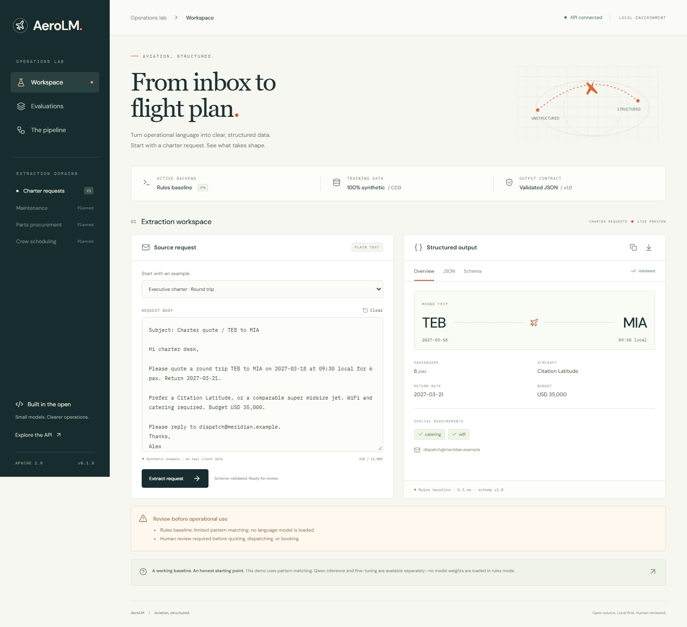
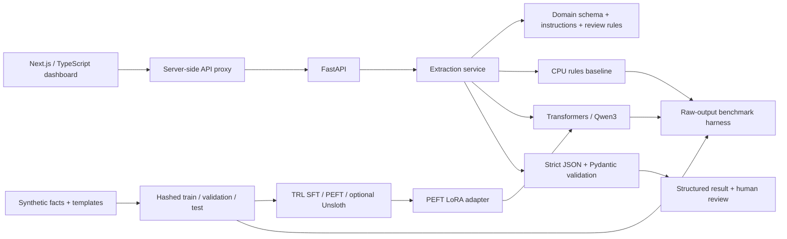

# AeroLM

**Small models. Clearer aviation operations.**

An open-source lab for extracting structured JSON from aviation emails and operational
requests. Start with charter flights: airports, itinerary, dates, passenger count,
aircraft preferences, budget, contact, and service requirements.

Run the complete demo on a CPU with no model download. When you're ready, evaluate
Qwen3 **0.6B or 1.7B**, train a **LoRA/QLoRA** adapter, and measure whether it actually
improves extraction. The engine is organized around domain contracts so other aviation
workflows and industries can share the same inference and validation path.

> **Release status:** functioning rules demo, HF inference, and two completed CPU LoRA experiments.
> No fine-tuned weights are bundled. The newer adapter scored 98.57% F1 on a controlled
> 300-request synthetic test. The first adapter underperformed rules on the authored
> challenge. All models are experimental and require human review.



## Quick start — no GPU

Prerequisites: Python 3.12 (3.11–3.13 supported), [uv](https://docs.astral.sh/uv/),
Node.js 24, npm. Start in the repository root.

```sh
uv sync --frozen --extra dev
uv run uvicorn aerolm.api:app --host 127.0.0.1 --port 8000
```

In a second terminal:

```sh
cd web
npm ci
npm run dev
```

Open **http://127.0.0.1:3000**. API documentation: **http://127.0.0.1:8000/docs**.
Load a synthetic example, extract, inspect the overview or JSON, and download the result.
The dashboard's Evaluations tab reads committed reports from the API. It never displays
invented fine-tuning scores. Run the API from the repository root to load those reports.

The default `rules` backend needs no PyTorch, GPU, API key, hosted inference, or training.
The Next.js proxy forwards to `http://127.0.0.1:8000`; change `AEROLM_API_URL` in
`web/.env.local` if needed. API configuration comes from environment variables or a root
`.env`; see [.env.example](.env.example) and [web/.env.example](web/.env.example).

### Docker

```sh
docker compose up --build
```

The same URLs work. Both services run as unprivileged users and publish loopback-only
ports. Compose waits for API readiness. The default images contain no model weights.
Docker is not installed in the initial development environment, so local container
execution was not verified; the container CI job builds and smoke-tests the stack.

## Example

```text
Please quote a round trip TEB to MIA on 2027-03-18 at 09:30 local
for 6 pax. Return 2027-03-21. Citation Latitude preferred.
WiFi and catering required. Budget USD 35,000.
Reply to dispatch@meridian.example.
```

`POST /v1/extract` with `{"text": "…", "domain": "charter"}` returns this `data` object
inside a response envelope containing backend identity, warnings, latency, schema version,
and `requires_review: true`:

```json
{
  "request_type": "charter",
  "trip_type": "round_trip",
  "legs": [{
    "origin": "TEB",
    "destination": "MIA",
    "departure_date": "2027-03-18",
    "departure_time": "09:30",
    "time_zone": "local"
  }],
  "passengers": 6,
  "aircraft_category": "super_midsize_jet",
  "aircraft_preference": "Citation Latitude",
  "return_date": "2027-03-21",
  "budget": "USD 35,000",
  "special_requirements": ["catering", "wifi"],
  "contact_email": "dispatch@meridian.example"
}
```

Unknowns stay null or empty. City names do not select an airport; relative dates have no
implicit current-date reference. Round trips use the outbound leg plus `return_date`;
multi-leg requests use ordered `legs`. Airport codes are syntax-checked, not verified
against a directory. Explicit ISO/long-form dates need a year; ambiguous numeric dates
remain unresolved. UTC/Zulu and explicitly local times are preserved without conversion.

## Architecture



| Area | Location | Responsibility |
| --- | --- | --- |
| Domain contracts | `src/aerolm/domains/` | Pydantic charter schema and review checks |
| Core | `core.py`, `service.py` | Registry, backend protocol, strict validation |
| Backends | `src/aerolm/backends/` | Clearly separate rules and local HF generation |
| Data | `data/generate.py`, `data/` | Independent synthetic labels, split hashes, challenge fixtures |
| Training | `training.py`, `configs/` | Completion-only SFT, LoRA, NF4 QLoRA, optional Unsloth |
| Evaluation | `evaluation.py`, `benchmarks/` | Slot metrics, strict output validity, raw predictions |
| API | `api.py` | Limits, optional bearer auth, bounded inference, discovery |
| Dashboard | `web/` | Responsive workspace, JSON/schema views, exports, report log |

Only charter is implemented. Maintenance, parts procurement, and crew scheduling are
explicitly marked planned. See [extending the engine](docs/EXTENDING.md) for adding a
domain or another industry without rewriting the service.

## Synthetic dataset

```sh
uv run aerolm generate --seed 42 --train 1000 --validation 120 --test 120
```

Creates ignored `data/generated/{train,validation,test}.jsonl` and `manifest.json`.
Five training, two validation, and three test phrasing families are disjoint. Seeded
structured facts are sampled first and rendered second; labels never come from the
rules extractor. Exact duplicate text across splits is rejected. Periodic examples
teach abstention for relative dates, missing passengers, and ambiguous cities.

The committed [24-case challenge set](data/charter_challenge.jsonl) has independently
authored labels and harder formats, including multi-leg requests. It is never passed
to training. The generator's vocabulary is small and shares operational terms with the
rules baseline; its very high rules score should be read in that context. See the
[data card](docs/DATA_CARD.md) for composition, provenance, and coverage gaps.

## Training methodology

Use Linux or WSL2 with a compatible NVIDIA CUDA GPU for the GPU recipes. Explicit CPU
LoRA is also supported with `configs/cpu-lora.toml`; GPU recipes still fail when CUDA
is unavailable. The CPU demo works natively on Windows, Linux, or macOS.
No cloud training, paid service, or automatic model publication is used.

### Full local CPU experiment

The CPU recipe trains Qwen3-0.6B on 1,000 synthetic requests for three epochs, using
120 validation requests and 120 template-held-out test requests. BF16 is explicit and
requires an efficient BF16 CPU implementation; use float32 on other CPUs. The completed
Ryzen 9 9950X run took **114.6 minutes for training**, excluding generation-based
evaluations. It trained 10,092,544 adapter parameters over 375 optimizer steps, using
12 CPU threads and a 1,024-token sequence limit. This run used LoRA, without 4-bit
quantization or Unsloth. Hardware changes can substantially change runtime.

```sh
uv sync --frozen --extra ml --extra dev
uv run --no-sync python scripts/run_local_experiment.py --activate
```

The runner records progress in `artifacts/full-cpu/experiment.json` and
`artifacts/full-cpu/adapter/progress.jsonl`. It saves resumable checkpoints every 25
optimizer steps, then evaluates base and adapter models on the full generated test set
and the unchanged challenge set. Both evaluations use the same pinned model revision,
BF16 CPU precision, 12 CPU threads, prompt, and greedy decoding. Completed matching
phases can be reused when restarting the command; changed data/configs are rejected.

In another terminal, check status without loading the model:

```sh
python scripts/experiment_status.py
```

Completed reports and raw predictions go to `benchmarks/results/`, with the measured
comparison in `artifacts/full-cpu/comparison.json`. `--activate` writes an ignored local
`.env` selecting the adapter only after training/evaluation finish and a real demo
extraction passes schema validation. Existing unrelated `.env` values are preserved.
No trained weights are committed or uploaded. The CPU trainer can omit expensive token
entropy/accuracy logging while preserving the identical supervised objective; held-out
extraction metrics remain the quality measure.

### Second experiment: missing facts and stronger baselines

Version 2 adds sparse requests, corrections, negation, multiple legs, explicit nulls,
source-mention review, and optional few-shot/constrained generation. Historical data,
weights, and results are preserved. The new runner separates validation selection from
the new 300-request test set and never activates an adapter automatically.

```sh
uv sync --frozen --extra dev --extra ml --extra structured
uv run --no-sync python scripts/run_v2_experiment.py --stage prepare
uv run --no-sync python scripts/run_v2_experiment.py --stage pilot
```

The pilot uses 240 training examples, one epoch, and 24 validation requests. Full
training uses 2,000 examples for three epochs. See the [v2 experiment guide](docs/EXPERIMENT_V2.md)
for the full/test stages, evaluation boundaries, and source-evidence limitations.
Do not infer improved accuracy from implementing these changes; only completed model
evaluations establish the next measured result.

The completed full v2 run trained on **2,000 synthetic requests for three epochs**.
On the separate 300-request synthetic test it achieved **98.57% F1 and 284/300 exact
requests**; rules scored 79.00% F1 and 63/300 exact. The model returned valid JSON
for all 300 requests and passed schema validation for 297. Its 16 incorrect requests
all involved lowercase airport codes withheld from training. The test shares a clause
renderer and vocabulary with training; it does not establish real-world reliability.
See the [v2 guide](docs/EXPERIMENT_V2.md) for the pilot, full results, raw outputs,
failure analysis, and the evidence-ordering reproducibility correction.

### CUDA LoRA / QLoRA

```sh
uv sync --frozen --extra ml --extra cuda --extra dev
uv run --no-sync aerolm generate
# Optional two-step wiring check; use a separate output directory.
uv run --no-sync aerolm train --config configs/qlora.toml --max-steps 2 --output artifacts/smoke-adapter
# Full configured run:
uv run --no-sync aerolm train --config configs/qlora.toml --output artifacts/adapter
```

Use `configs/lora.toml` for unquantized LoRA. Configs pin the 0.6B base to Hub commit
`c1899de289a04d12100db370d81485cdf75e47ca`. To train the larger model, set
`model_id = "Qwen/Qwen3-1.7B"` and
`revision = "70d244cc86ccca08cf5af4e1e306ecf908b1ad5e"` in your chosen config.
Actual memory demand depends on sequence
length, hardware, precision, and batch settings; this repository publishes no measured
VRAM or throughput claims. Lower `max_length` only after checking that labels still fit.
Resume an interrupted run with `--resume artifacts/adapter/checkpoint-N` and the same
data/config/output; avoid reusing a nonempty output directory for a fresh run.

| Parameter | Default |
| --- | --- |
| Base model | `Qwen/Qwen3-0.6B` |
| Objective | Supervised, completion-only causal language modeling |
| LoRA | Rank 16, alpha 32, dropout 0; attention and MLP projections |
| QLoRA | 4-bit NF4, double quantization; bf16 when supported, otherwise fp16 |
| Learning rate / schedule | 2e-4 / cosine, 5% warmup |
| Epochs / effective batch | 3 / 8 examples on one GPU |
| Context / packing | 3,072 tokens / disabled |
| Seed | 42 for data and training |
| Qwen thinking | Disabled for training prompts and inference |

Only the completion is supervised. Oversized training examples raise an error rather
than losing target fields to truncation. Validation is evaluated each epoch; test data
is not loaded by the trainer. The saved adapter includes the tokenizer and
`run_manifest.json`, which records the immutable resolved base SHA, config and data
hashes, package versions, GPU/CUDA details, and completion status. For reruns, pin
`revision` to that SHA. Fixed seeds do not guarantee identical GPU results across hardware.

Optional Unsloth uses the same dataset and objective in its own explicit configuration:

```sh
uv sync --frozen --extra ml --extra cuda --extra unsloth --extra dev
uv run --no-sync aerolm train --config configs/unsloth.toml --output artifacts/adapter-unsloth
```

The Unsloth extra is Linux-only, pinned to a compatible dependency set, and requires CUDA.
It is not silently installed by the CPU demo. Actual GPU training and the Unsloth runtime
have not been exercised in this development environment. The optional ML integration test
does perform a real CPU optimizer step on a tiny random Qwen model and checks completion
masking and LoRA serialization; it does not train the pretrained extraction model.

For a GPU container:

```sh
docker build -f Dockerfile.gpu -t aerolm-gpu .
docker run --rm --gpus all -v aerolm-artifacts:/app/artifacts aerolm-gpu aerolm generate --output artifacts/data
docker run --rm --gpus all -v aerolm-artifacts:/app/artifacts aerolm-gpu aerolm train --data artifacts/data
```

The host needs NVIDIA Container Toolkit. The GPU image is provided separately and is not
built by the default Compose stack or CPU container CI.

## Actual benchmark results: first experiment

Measured on **November 8, 2026 (America/New_York)**, Python 3.12.13, Windows CPU.
The Qwen runs use the same pinned Qwen3-0.6B checkpoint, prompt, greedy decoding,
BF16 precision, and 12 CPU threads. All evaluation requests are synthetic. Full reports
include dependency versions, platform information, and dataset/adapter hashes.

| Backend / set | Requests | Precision | Recall | F1 | JSON valid | Schema valid | Exact record |
| --- | ---: | ---: | ---: | ---: | ---: | ---: | ---: |
| Rules / template holdout | 120 | 99.93% | 99.67% | 99.80% | 100% | 100% | 95.83% |
| Rules / authored challenge | 24 | 98.37% | 90.98% | 94.53% | 100% | 100% | 70.83% |
| Qwen3-0.6B base / template holdout | 120 | 0% | 0% | 0% | 0% | 0% | 0% |
| Qwen3-0.6B base / authored challenge | 24 | 0% | 0% | 0% | 0% | 0% | 0% |
| Qwen3-0.6B + CPU LoRA / template holdout | 120 | 99.74% | 99.74% | 99.74% | 100% | 100% | 96.67% |
| Qwen3-0.6B + CPU LoRA / authored challenge | 24 | 54.17% | 78.20% | 64.00% | 100% | 75% | 0% |

The base model wrapped its outputs in Markdown code fences and also made schema/fact
errors, including invented services and invalid field types. The evaluator rejects
those raw outputs; its zero strict score does not mean the model recognized no facts.
No JSON repair was applied to improve the score.

The first adapter produced valid JSON on all 144 requests, but JSON syntax alone is insufficient:
six challenge responses failed the schema and none matched every expected fact. It invented
times, aircraft preferences, and contact addresses when these were absent. The generated
holdout shares the training vocabulary and mostly complete requests; it does not establish
generalization to sparse operational messages. **Rules remain the stronger challenge
baseline.** The subsequent v2 experiment addresses data coverage and has its own results
on a separate synthetic test; it has not been measured on this original challenge.

The [completed training manifest and comparisons](benchmarks/runs/) record the actual
CPU recipe and measured deltas. Median adapter inference was 6.72 seconds per generated
request and 5.54 seconds per challenge request, excluding model loading.

Reports and per-request raw predictions are committed in [benchmarks/results](benchmarks/results).
Formatting validity is expected to be perfect for rules, which serializes a Pydantic model;
it does not prove extraction quality. Lower challenge exact-match accuracy exposes missed
facts and false positives that the generated templates rarely produce. See
[benchmark methodology and failure analysis](benchmarks/README.md).

### Reproduce the rules results

```sh
uv run aerolm generate
uv run aerolm evaluate --dataset data/generated/test.jsonl --output artifacts/rules-generated.json --label rules-generated
uv run aerolm evaluate --dataset data/charter_challenge.jsonl --output artifacts/rules-challenge.json --label rules-challenge
uv run python scripts/verify_benchmarks.py
```

### Compare base and fine-tuned Qwen

After training, copy `model_revision` from `artifacts/adapter/run_manifest.json` and use
that exact SHA for both evaluations. Replace `BASE_SHA` below. The adapter loader also
uses the base revision recorded in its manifest.

```sh
uv run --no-sync aerolm evaluate --backend hf --device cuda --revision BASE_SHA --dataset data/generated/test.jsonl --output artifacts/qwen-base.json --label qwen-base
uv run --no-sync aerolm evaluate --backend hf --device cuda --revision BASE_SHA --adapter artifacts/adapter --dataset data/generated/test.jsonl --output artifacts/qwen-tuned.json --label qwen-tuned
uv run --no-sync aerolm compare artifacts/qwen-base.json artifacts/qwen-tuned.json
```

Repeat on the challenge set with different report filenames. Comparison refuses different
data, prompts, model IDs, revisions, or generation settings. The same greedy, non-thinking
decoding is used for both. Do not call a rules-versus-adapter difference a fine-tuning gain.

Scoring uses exact non-null field/value facts. A wrong value is one FP plus one FN;
omissions are FN. Nulls and empty lists earn no true-negative credit. Requirements are
unordered; legs are ordered. Constant `request_type` is excluded. Invalid schema outputs
receive zero slot credit; raw JSON validity is measured independently before validation.
Reports include per-field metrics, dataset and prompt hashes, adapter hashes, raw
predictions, generation settings, and latency excluding model loading. Predictions are
not repaired before scoring, and runtime failures stop evaluation rather than disappearing.

## API and optional model inference

| Endpoint | Purpose |
| --- | --- |
| `GET /healthz` | Actual backend/model/adapter readiness |
| `GET /v1/domains` | Implemented domain discovery |
| `GET /v1/schema/charter` | Pydantic-generated JSON Schema |
| `GET /v1/examples` | Synthetic demonstration inputs |
| `GET /v1/benchmarks` | Committed measured reports |
| `POST /v1/extract` | Validated extraction with review warnings |

For Qwen inference, install `--extra ml`, then place this in root `.env`:

```dotenv
AEROLM_BACKEND=hf
AEROLM_MODEL_ID=Qwen/Qwen3-0.6B
AEROLM_DEVICE=cpu
# Optional after training:
# AEROLM_ADAPTER_PATH=artifacts/adapter
# For a reproducible base run:
# AEROLM_MODEL_REVISION=<immutable Hub SHA>
```

Start with `uv run --no-sync uvicorn aerolm.api:app --port 8000`. The first HF load
downloads public weights and requires considerably more RAM/time than rules mode.
Use `cuda` or `auto` when appropriate. Configuration is fixed at startup; restart to
switch backends. Missing ML packages, absent CUDA when requested, or mismatched/incomplete
adapter manifests fail explicitly. There is no automatic fallback to rules.

The API rejects blank text, unknown fields/domains, and messages over 12,000 characters.
HF additionally rejects schema-plus-input prompts over the configured token budget.
Strict validation rejects code fences, trailing text, duplicate JSON keys, nonstandard
constants, extra fields, invalid dates, and out-of-range passenger counts. Failed model
outputs return 502; busy inference returns 503. One active request is admitted per process
to bound model concurrency. Always review outputs; schema validity does not verify facts.

Set a matching `AEROLM_API_KEY` in API and dashboard server environments to enable
bearer authentication on direct extraction calls. The proxy token is server-only and
does not authenticate dashboard visitors. Keep loopback bindings for local use; add
dashboard auth, TLS, rate limits, and ingress controls before hosting. See [SECURITY.md](SECURITY.md).

## Tests and CI

```sh
uv sync --frozen --extra dev
uv run pytest
uv run python scripts/verify_benchmarks.py
cd web
npm ci
npm run build
npx playwright install chromium
npm run test:e2e
```

Python tests cover API contracts/auth/concurrency, schema rejection, abstention, registry
extension, independent data labels, reproducibility, leakage checks, metric arithmetic,
invalid-output scoring, and training-target construction. Optional `ml` tests are skipped
without ML dependencies. Browser tests run against the actual API at desktop/mobile sizes;
the error-path test deliberately injects a 503. Playwright starts local servers as needed.

GitHub Actions runs Python 3.11/3.12/3.13 tests, a tiny random-weight CPU ML smoke test,
verifies committed benchmark metrics, builds Next.js, exercises the dashboard, and
builds/smoke-tests CPU containers. CI does
not fabricate GPU training or model evaluation results.

## Roadmap and contribution

- Expand independently authored synthetic formats, thread corrections, multi-leg training,
  and an unseen evaluation set.
- Execute a GPU training run; publish the actual base/adapter comparison and failure analysis.
- Add explicit domain contracts for maintenance, parts, and crew requests.
- Add calibrated abstention and fact-grounding evaluation before considering operational use.

See [CONTRIBUTING.md](CONTRIBUTING.md), the [data card](docs/DATA_CARD.md), and the
[model card](docs/MODEL_CARD.md). Aviation experience helps identify useful problems;
this project deliberately uses independently authored code and synthetic examples.
Do not contribute employer code, internal workflows/documents, or customer information.
Check applicable workplace policies before publishing work-related side projects.

## License and references

Code: [Apache-2.0](LICENSE). Bundled synthetic data: [CC0-1.0](data/LICENSE).
Base model licenses and notices remain with their upstream authors.

- [Qwen3-0.6B model card](https://huggingface.co/Qwen/Qwen3-0.6B)
- [Qwen3-1.7B model card](https://huggingface.co/Qwen/Qwen3-1.7B)
- [TRL SFT documentation](https://huggingface.co/docs/trl/v0.24.0/en/sft_trainer)
- [PEFT LoRA documentation](https://huggingface.co/docs/peft/main/en/conceptual_guides/lora)
- [Unsloth Qwen3 guide](https://unsloth.ai/docs/models/tutorials/qwen3-how-to-run-and-fine-tune)
